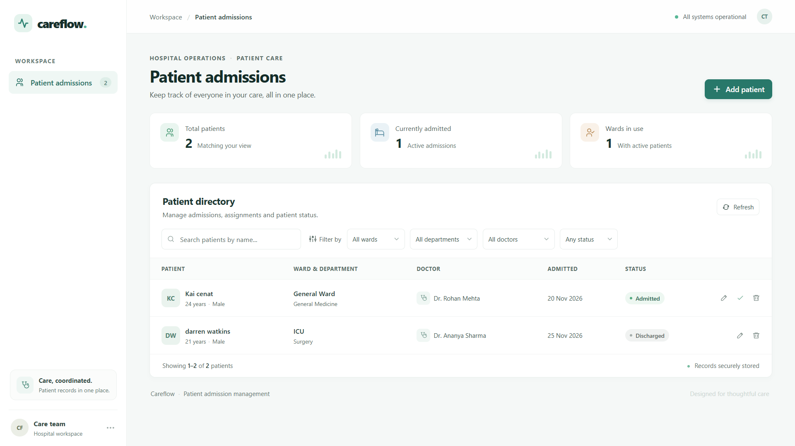
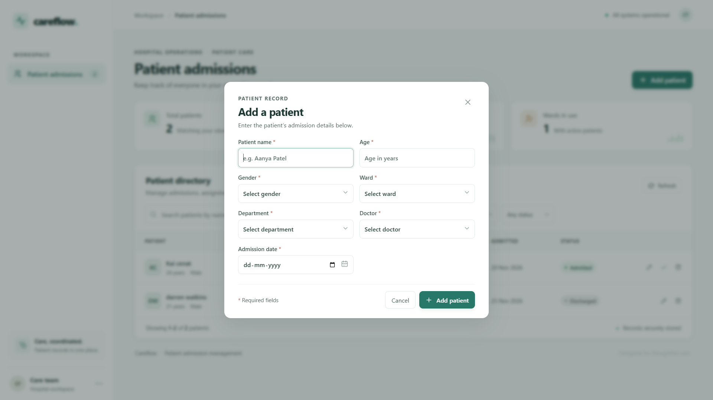

# Careflow - Patient Admission Management

Patient Admission Management app for the DScribe Software Engineer Intern Round 1 task. Hospital staff can manage admitted patients, their ward and department assignments, and admission status.

## Submission links

- **GitHub:** [Karanraj-6/DScribe](https://github.com/Karanraj-6/DScribe)
- **Live app:** [d-scribe-rouge.vercel.app](https://d-scribe-rouge.vercel.app/)
- **Backend API docs:** [d-scribe-wx1d.vercel.app/docs](https://d-scribe-wx1d.vercel.app/docs)
- **Backend readiness:** [API health and Supabase status](https://d-scribe-wx1d.vercel.app/api/health/ready)

The live frontend is connected to the deployed FastAPI backend and Supabase PostgreSQL.

## Screenshots

### Patient directory



### Add patient form



## Technology stack

- **Frontend:** React.js with Vite
- **Backend:** Python FastAPI with Pydantic v2
- **Database:** Supabase PostgreSQL
- **Backend deployment:** Vercel Python runtime
- **Frontend deployment:** Vercel

## Patient fields

| Field | Rules and values |
| --- | --- |
| Name | Required; English letters and spaces between name parts |
| Age | Required whole number from 0 to 120 |
| Gender | Required selection: Female, Male, or Other |
| Ward | Required selection from the available ward list |
| Department | Required selection from the available department list |
| Doctor | Required selection from the available doctor list |
| Admission date | Required; today or an earlier date in India Standard Time |
| Status | Admitted or Discharged; new patients start as Admitted |

## Required features

- Add and view patient records
- Search patients by name
- Filter by ward, department, and doctor; the directory also supports status filtering
- Edit patient details
- Delete a patient after confirmation
- Mark an admitted patient as discharged
- Responsive layout for mobile, tablet, and desktop
- No login or signup, as permitted by the task

## Validation

The frontend and backend both validate patient input. FastAPI uses Pydantic models, and PostgreSQL also enforces the allowed values and numeric ranges. Invalid backend requests return HTTP 422 with a clear field error.

- Name is required and accepts letters with spaces between name parts.
- Age is required and must be a whole number from 0 to 120.
- Gender, ward, department, and doctor are required selections from the allowed lists.
- Admission date is required and cannot be in the future.
- Status is limited to `Admitted` or `Discharged`.

## Run locally

Prerequisites: Python 3.12, Node.js with npm, `uv`, and a Supabase project.

### 1. Create the database table

For a new Supabase project, apply [`supabase/schema.sql`](supabase/schema.sql) in the Supabase SQL Editor. Alternatively, run the migration script as described below. The schema creates the `patients` table, constraints, indexes, and the update timestamp trigger. Patient data is stored in Supabase and persists across API restarts.

### 2. Configure and run the FastAPI backend

In PowerShell:

```powershell
cd backend
Copy-Item .env.example .env
```

Set `SUPABASE_URL` and `SUPABASE_SECRET_KEY` in `backend/.env`. Keep secret keys out of GitHub. `FRONTEND_ORIGINS` should include `http://localhost:5173` for local development.

Install the Python dependencies and start the API:

```powershell
uv sync
uv run uvicorn app.main:app --reload --port 8000
```

Local API docs: <http://localhost:8000/docs>

The Supabase schema is already applied for the live project. To apply it to another database using the migration script, set `DATABASE_URL` in `backend/.env` to the PostgreSQL connection URI from Supabase Dashboard > Connect, then run this from `backend`:

```powershell
uv run python scripts/apply_schema.py
```

`DATABASE_URL` contains the database password and is only needed for migrations; the API uses the Supabase project URL and server-side secret key at runtime. The migration uses pg8000 over TLS and submits the complete SQL file without splitting statements.

### 3. Configure and run the React frontend

In a second PowerShell window:

```powershell
cd frontend
Copy-Item .env.example .env
npm ci
npm run dev
```

Open <http://localhost:5173>. The local `.env.example` points the frontend to `http://localhost:8000`.

## Vercel deployment

The frontend and backend are separate Vercel projects from this repository:

- **Frontend project:** Root Directory `frontend`.
- **Backend project:** Root Directory `backend`; FastAPI framework. `api/index.py` exports the app from `app.main`, and `vercel.json` selects FastAPI.

The backend Vercel project needs these environment variables:

- `SUPABASE_URL`
- `SUPABASE_SECRET_KEY`
- `FRONTEND_ORIGINS=https://d-scribe-rouge.vercel.app`

The production frontend API origin is set in [`frontend/.env.production`](frontend/.env.production). For another frontend deployment, set `VITE_API_URL` to the backend origin (without an `/api` suffix) in the frontend Vercel project. The backend CORS setting must include that frontend's origin, without a trailing slash.

## API routes

| Method | Route | Purpose |
| --- | --- | --- |
| `GET` | `/api/health` | Liveness check |
| `GET` | `/api/health/ready` | Database readiness check |
| `GET` | `/api/options` | Allowed gender, ward, department, and doctor values |
| `GET` | `/api/patients` | List, search, and filter patients |
| `POST` | `/api/patients` | Add a patient |
| `PUT` | `/api/patients/{id}` | Edit patient details |
| `PATCH` | `/api/patients/{id}/status` | Mark a patient admitted or discharged |
| `DELETE` | `/api/patients/{id}` | Delete a patient |

`GET /api/patients` accepts `search`, `ward`, `department`, `doctor`, `status`, `limit`, and `offset` query parameters.

## Submit

Email the GitHub repository and live app links to `pramod@dscribe.in` and `suhasm@dscribe.in`. Use your full name in the email subject. The task deadline is Wednesday, 25 November 2026, 11:59 PM IST.
